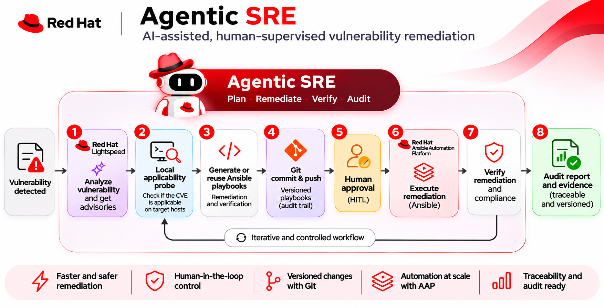

<div align="center">

# Agentic SRE: From Detection to Verified Remediation

**An AI agent can suggest a patch. Who verifies that the right host needs it — and that the fix actually worked?**

*Investigate → Validate → Approve → Remediate → Independently verify → Audit*

</div>

## The problem

A detected CVE is not proof that a particular host is vulnerable. A successful automation job is not proof that remediation succeeded. And an AI proposal must not approve its own production changes.

This **minimal, sanitized lab reference** demonstrates a host-scoped workflow connecting vulnerability context through MCP, human-in-the-loop decision gates, deterministic Ansible execution through AAP, and independent verification. It is **not** a turnkey production remediation system.

<div align="center">



</div>

## What is included

| Path | Purpose |
|---|---|
| `.cursor/skills/agentic-sre-remediate/` | Orchestrating skill, approval prompts, decision logic and evidence rules |
| `playbooks/remediate-cve-2026-114406.yml` | One *historical* package-remediation example, bounded to a single explicit host |
| `playbooks/verify-cve-2026-114406.yml` | Independent read-only verification example |
| `scripts/aap_project_sync.py` | Explicitly configured AAP project-sync helper |
| `scripts/generate-remediation-evidence-report.py` | Generates a **local**, potentially sensitive evidence report (output is ignored by Git) |
| `scripts/check-publication.py` | Static checks before publication, enforced by a small GitHub Actions workflow |
| `SECURITY.md` / `.gitignore` | Disclosure and artifact-exclusion guidance |

**Not included:** real execution reports, host inventories, credentials, lab endpoints, controller configurations, private Git history, HTML evidence, demo fixtures, duplicated agent-client directories or unrelated historical CVE playbooks.

## Safety model

The main skill requires independent approvals for read-only probing, the remediation plan, Git changes, remediation execution (including reboot if applicable), post-change verification, and any report publication. Its verdicts distinguish `REMEDIATED`, `NOT_REMEDIATED`, and `VERIFICATION_ERROR`.

The prompts in a skill are **not** security-enforcement boundaries. Enforce least-privilege MCP credentials, server-side authorization, target-specific AAP limits and change-management approvals outside the LLM.

### Example playbooks: documentation, not universal fixes

The two CVE-2026-114406 playbooks illustrate remediation/verification separation. They contain an illustrative **historical** RHSA/package version and are intentionally limited to a specific RHEL release/architecture. **Do not execute them based on this README alone.** Independently confirm current vendor advisories, package versions, system applicability, privilege scope, backups and maintenance requirements.

Both playbooks require `expected_hostname` to be supplied explicitly. In AAP, additionally set an **exact one-host** Job Template limit. Never run against a broad inventory by accident.

```bash
# Read-only syntax check (requires Ansible; does NOT connect to a host)
ansible-playbook --syntax-check playbooks/remediate-cve-2026-114406.yml
ansible-playbook --syntax-check playbooks/verify-cve-2026-114406.yml
```

### AAP project sync

```bash
export AAP_CONTROLLER_URL='https://controller.example.org'   # replace for your own approved environment
export AAP_PROJECT_ID='123'                                    # replace
# Supply AAP_API_TOKEN from a secret manager; NEVER add it to Git.
python3 scripts/aap_project_sync.py --project-id "$AAP_PROJECT_ID" --check-auth-only
# After explicitly approving the project sync:
python3 scripts/aap_project_sync.py --project-id "$AAP_PROJECT_ID"
```

## Required external components

The orchestrator **delegates** to additional upstream Agentic SRE skills (`/cve-validation`, `/mcp-aap-validator`, `/playbook-executor`, etc.) and MCP integrations with vulnerability intelligence and AAP. These are **not bundled** here. Installing this repository alone does not provide the external skills, APIs or credentials. Refer to [the skill map](.cursor/skills/agentic-sre-remediate/references/05-skill-map.md) before a live demonstration.

## Before every commit

```bash
python3 scripts/check-publication.py
git status --short
git diff --cached --check
git diff --cached --stat
```

Generated reports, logs and inventory evidence stay private; **do not force-add ignored files**. A scanner reduces accidental leaks but cannot guarantee their absence. See [SECURITY.md](SECURITY.md).

## Project status and licensing

This is a research / lab example, not production-ready and not a representation of a customer deployment. The repository currently carries **GPL-3.0** at its GitHub root. Distribution of any adapted upstream skill/code is conditional on the relevant original rights and licenses; confirm compatibility and attribution before treating this work as safely relicensable. This publication includes no actual customer execution records.
